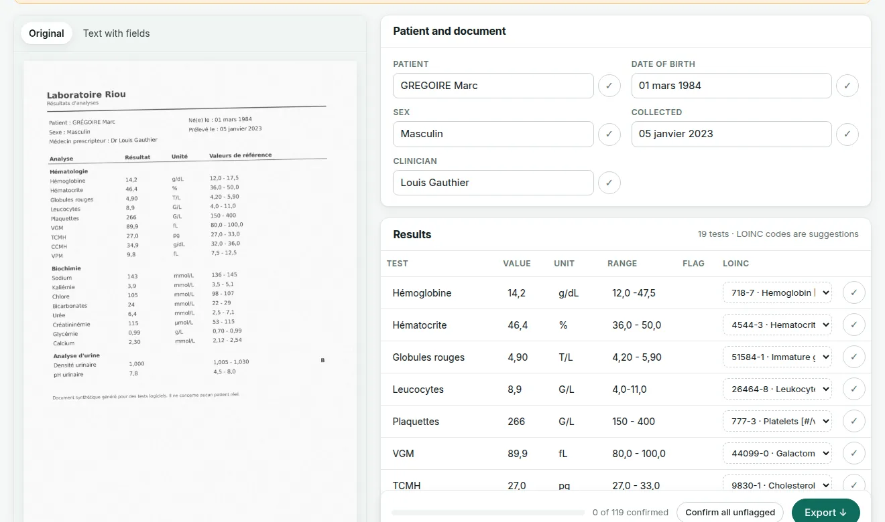
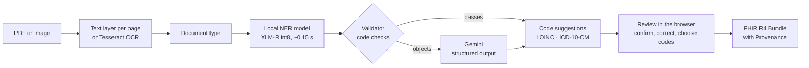

# Nwoma

**Clinical documents in, coded and verified records out.**

Nwoma reads lab reports and referral letters, in English or French, digital or scanned. It extracts
every field, suggests LOINC and ICD-10-CM codes, flags what a person should check, and exports a
FHIR R4 record that says which fields that person verified. It transcribes; it never diagnoses.

**[Try the live demo](https://kobi-ampem.github.io/nwoma/)** · [open a scanned French lab report](https://kobi-ampem.github.io/nwoma/?sample=lab-report-fr-scanned.pdf) · [how it works](https://kobi-ampem.github.io/nwoma/#/how)

*Nwoma* is Asante Twi for paper, or document.



## Results

Measured on 500 held-out synthetic documents (300 lab reports, 200 referral letters; half
French, half scanned, including layouts no model trained on). Full report:
[`docs/evaluation.md`](docs/evaluation.md).

| | F1 | Documents fully correct | Sent to the LLM | Time per document |
|---|---|---|---|---|
| Local model only (fine-tuned XLM-R, int8, CPU) | 0.920 | 57.8% | 0% | 0.15 s |
| Gemini only | 0.955 | 59.4% | 100% | 2.7 s |
| **Cascade: local first, Gemini when a check fails** | **0.955** | **62.0%** | **33%** | **1.2 s** |

| Coding | Top-1 | Top-5 |
|---|---|---|
| Lab test → LOINC | 59.8% | 81.0% |
| Diagnosis → ICD-10-CM (English / French) | 43.6% / 44.2% | 76.4% / 65.1% |
| With the coding agent (LOINC / ICD-10-CM, 40 documents) | 85.2% / 93.0% | |

The cascade matches the LLM's accuracy with a third of the calls, and gets more documents fully
right than either extractor alone. Code suggestions are right first time about half the time,
which is why a person chooses from five.

## How it works



1. **Read.** Each PDF page from its text layer, or by OCR (English and French) when it is scanned.
2. **Extract locally.** A fine-tuned multilingual token classifier tags 16 field types.
3. **Validate.** Plain-code checks catch what model confidence misses: a flag the value and range
   contradict, an impossible date, a missing required field.
4. **Fall back.** Only documents the validator objects to go to Gemini; the answer with fewer
   problems is kept.
5. **Code.** Hybrid retrieval (keyword + multilingual embeddings) over LOINC and ICD-10-CM,
   reranked by unit, specimen, usage and the official coding rules.
6. **Review and export.** The reviewer sees the original beside the fields, confirms or corrects
   them, chooses codes, and downloads FHIR R4 (for systems) or a readable summary (for people).

An **agent** (Gemini with four tools, at most five steps) assigns codes where search alone fails,
such as French abbreviations: top-1 rises from 64% to 85% for LOINC and from 49% to 93% for
ICD-10-CM, at about 3.5 model calls per document. An **MCP server** offers extraction, coding and FHIR export
to AI assistants.

## Who it is for

The people who handle incoming clinical paperwork: medical secretaries and records staff, the
clinicians who check results and referrals, and the health-IT teams who connect it to a records
system through the API or MCP.

## Design decisions

Each is recorded in [`docs/adr/`](docs/adr/):

- **Synthetic data only** (ADR 0001): Synthea patients rendered into documents, so every label is
  exact and no real patient data is ever used.
- **Route around the model's limit** (ADR 0002): the local model learns column order and fails on
  unseen orders, confidently. Routing uses validator checks, not confidence.
- **Minimal AWS, hard cost cap** (ADR 0003): one Lambda container behind a function URL, about
  $0.25 a month. A usage alarm switches the API off within minutes of abnormal load, and a
  budget alarm at $1.99 backs it up.
- **Nwoma stores nothing.** A document is read, answered and forgotten. The exception to know
  about: documents that fail a validator check are sent to Google's Gemini API, and its free
  tier may keep what it receives, so the public demo takes test documents only. A paid tier or
  a self-hosted model removes that. No accounts: they would mean
  storing regulated health data (HDS in France, HIPAA in the US, Ghana's Data Protection Act).
  Nwoma converts documents; the hospital's records system stores and shares them, and FHIR is
  what those systems import.

## Business model

Business design for the pitch; only the Free behaviour is built.

| Tier | Price | What it includes |
|---|---|---|
| Free | €0 | 100 documents a month, local model only, so free use can never run up a bill |
| Clinic | €49 a month (regional price for West Africa) | 2,000 documents, then €0.03 each; the full cascade with the LLM |
| Hospital | Annual licence | Compliant hosting, records-system integration, single sign-on, audit log, SLA |

## Repository

| Path | What |
|---|---|
| `datagen/` | Synthetic lab reports and referral letters from Synthea, with exact labels |
| `ocr/` | Text layer per page, Tesseract OCR, work limits |
| `extract/` | NER model (training and inference), Gemini extractor, validator, cascade |
| `normalise/` | Field normalisation, hybrid retrieval, LOINC and ICD-10-CM mapping |
| `agent/` | The coding agent |
| `api/` | FastAPI service and FHIR R4 export |
| `mcp_server/` | MCP server |
| `web/` | The review app (React + TypeScript, GitHub Pages) |
| `evals/` | Evaluation scripts; results in `evals/results/` |
| `infra/` | CloudFormation and SAM templates |
| `docs/` | [Evaluation report](docs/evaluation.md), [model card](docs/model_card.md), [ADRs](docs/adr/), [project brief](docs/PROJECT_BRIEF.md) |

## Run it locally

Python 3.12 with [uv](https://docs.astral.sh/uv/), Tesseract with English and French, and Node 24.

```bash
uv sync
uv run pytest                     # 142 tests
uv run uvicorn api.app:app        # API on :8000 (needs models/ner and data/; see below)
cd web && npm ci && npm run dev   # review app on :5173
```

The API needs files the repository does not hold: the trained model (`models/ner/`, from
`notebooks/train_ner.ipynb`), the LOINC table (`data/loinc/`, free registration at loinc.org) and
the ICD-10-CM file (`data/icd10cm/`, public, from CMS). Add `GEMINI_API_KEY` to `.env` to switch on
the LLM fallback.

## Licence

MIT. Synthetic data only: no real patient information is used anywhere.

## Third-party content

This material contains content from LOINC® (http://loinc.org). LOINC is copyright © Regenstrief
Institute, Inc. and the Logical Observation Identifiers Names and Codes (LOINC) Committee and is
available at no cost under the license at http://loinc.org/license. LOINC® is a registered
United States trademark of Regenstrief Institute, Inc.

The LOINC table is not redistributed in this repository. Download it from loinc.org (free
registration) and unzip it into `data/loinc/`. ICD-10-CM is published by the US Centers for
Medicare & Medicaid Services and is in the public domain.
